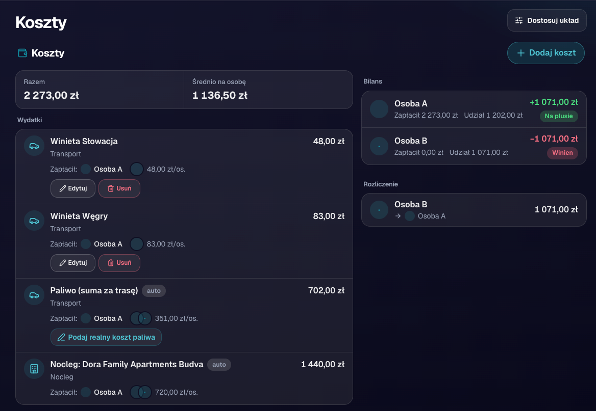

# planer wyjazdów

Apka do ogarniania wyjazdów w kilka osób. Wzięło się to stąd, że każdy nasz wyjazd kończył się na kilku czatach i arkuszu, którego nikt nie aktualizował, a na koniec i tak nikt nie wiedział, kto komu ile oddaje.

W jednym miejscu jest lista uczestników, kalendarz dostępności (każdy zaznacza, kiedy może), transport (kto jedzie jakim autem i ile wyjdzie paliwo), noclegi, wspólne koszty z rozliczeniem i checklisty. Wszystko siedzi na jednej stronie wyjazdu, a edycja jest w okienkach, bez przeładowywania strony.

## jak to się zmieniało

Pierwszą wersję napisałem w PHP i MariaDB na własnym, prostym MVC: router, kontrolery, modele na mysqli. Stała u mnie na Synology. Kawałki są w folderze `php/`.

Potem przeniosłem to na Next.js i Supabase (Postgres, logowanie, RLS, pliki), bo chciałem, żeby normalnie działało w sieci i żebym nie musiał pilnować serwera w domu. Logika z nowej wersji jest w `next/`.

## co jest w repo

To nie jest cały projekt, tylko kilka plików, żeby było widać, jak to jest zrobione. Całość trzymam prywatnie.

- `php/Router.php` - router z parametrami w ścieżce, np. `/trip/{share_code}`
- `php/web.php` - wszystkie trasy aplikacji
- `php/Trip.php`, `php/Route.php` - modele wyjazdu i trasy (etapy, auta, pasażerowie, paliwo)
- `next/settlement.ts` - rozliczenie kosztów i ograniczanie liczby przelewów
- `next/availability.ts` - szukanie terminów, które pasują największej liczbie osób

## rozliczenia

Dla każdej osoby liczę, ile zapłaciła, minus ile powinna zapłacić (jej część kosztów, w których brała udział). Potem największy dłużnik oddaje największemu wierzycielowi i tak w kółko, aż wszystko się wyzeruje. Nie zawsze wychodzi idealne minimum przelewów, ale przy 5-10 osobach różnicy praktycznie nie ma, a łatwo to sprawdzić na kartce.

## technologie

Stara wersja: PHP 8, MariaDB, własne MVC.
Nowa wersja: Next.js, TypeScript, Supabase, Tailwind.

Więcej o mnie: [alex-rakowski.hatchable.site](https://alex-rakowski.hatchable.site)
